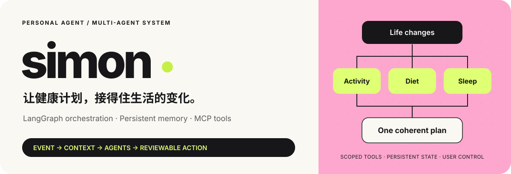
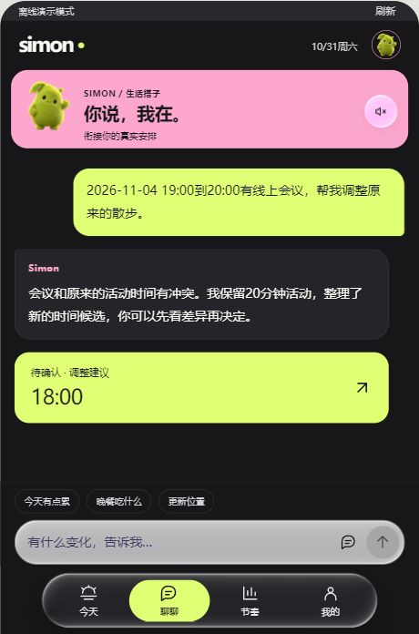
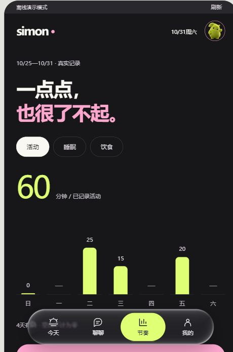
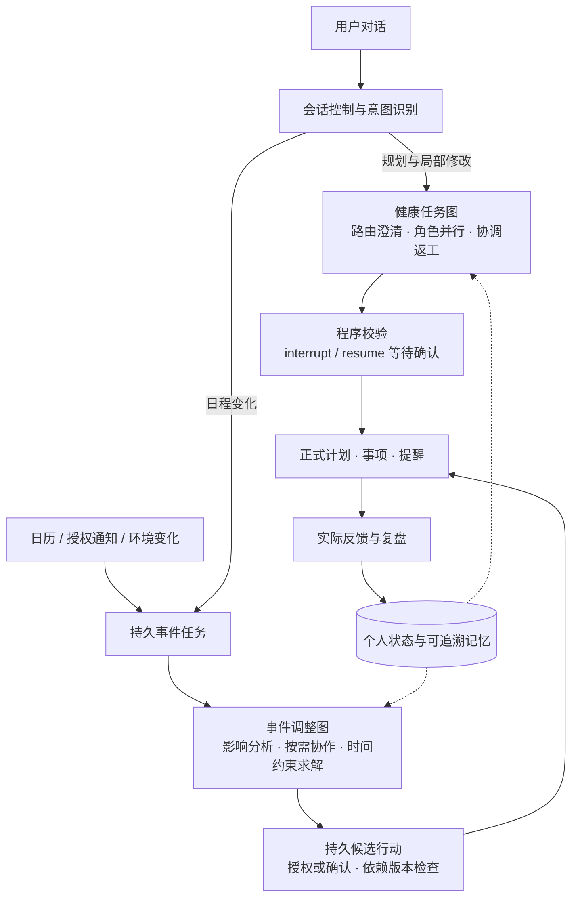

<div align="center">



**用多智能体协调运动、饮食与睡眠，让个人计划持续跟上生活变化。**

An event-driven health personal agent with LangGraph orchestration, persistent memory and MCP tools.


</div>

<p align="center">
  <a href="#why-simon">项目定位</a> ·
  <a href="#architecture">多智能体架构</a> ·
  <a href="#memory">记忆管理</a> ·
  <a href="#quickstart">快速开始</a> ·
  <a href="#scope">功能支持</a>
</p>

<a id="why-simon"></a>
## 从生成一次计划，到持续照顾一个人的日常

“今晚临时开会，原来的散步怎么办？”

Simon 将这句话作为日程变化处理：提取事件、识别冲突、按影响领域调度 Agent，结合已确认偏好、附近场地和天气生成调整候选。候选通过规则校验与授权检查后，才更新正式计划、事项和提醒；用户的实际反馈再进入下一次规划。

核心是一个持续闭环：**个人状态 → 外部事件 → 多智能体协作 → 受控行动 → 执行反馈 → 后续规划**。

<table>
  <tr>
    <td align="center" width="33%"><br /><strong>今天 · 变化有着落</strong></td>
    <td align="center" width="33%"><br /><strong>聊聊 · 衔接真实安排</strong></td>
    <td align="center" width="33%"><br /><strong>节奏 · 记录实际发生</strong></td>
  </tr>
</table>

## 工程重点

| 核心问题 | Simon 的实现 |
| --- | --- |
| **如何组织多角色协作？** | 两张显式 LangGraph：健康任务图负责规划，事件图负责增量调整；按领域分流、并行执行、状态汇合。 |
| **如何接续用户的生活？** | 持久化 Session / Goal / Task，将日程事件、候选行动、执行反馈和复盘关联起来。 |
| **如何处理窗口外的信息？** | 角色 ContextBuilder、跨任务偏好、原始存档及参数化历史补查，支持在工具循环中继续取证。 |
| **如何让建议落到真实环境？** | 通过 MCP 查询天气、POI、餐馆和双向步行路线；以候选 ID、来源、时效和预算约束生成计划。 |
| **如何控制模型行动？** | Pydantic 输出契约、程序校验、有限返工、检查点、人工确认及分项自动调整授权。 |
| **如何持续执行又避免重复？** | SQLite 持久任务、租约、幂等键、有限重试与依赖版本检查；模型/网络请求在业务锁外运行。 |

<a id="architecture"></a>
## 多智能体架构

### 两张图，分别处理完整规划与事件调整



> 上图聚焦规划与变更路径，完整节点图见[架构设计](docs/architecture.md)。只读问答可直接使用工具与 Advisor。`Review` 负责观测与复盘，程序规则负责校验；事件候选在图外行动层确认，健康任务图使用 `interrupt / resume`。

| 角色 | 主要职责 | 关键约束 |
| --- | --- | --- |
| **Router / Supervisor** | 识别请求、澄清缺项、选择领域与查询范围 | 已授权位置无需重复索要；只读查询不强行创建健康计划 |
| **Activity** | 比较场地与路线，提出运动选择 | 候选 ID 来自地图，往返时间不能挤占全部运动预算 |
| **Diet** | 结合偏好、预算、记录与餐馆证据提供饮食建议 | 菜品与营养建议以可核实证据为依据 |
| **Sleep** | 结合既有作息与反馈提供休息安排 | 卧床机会与实际睡眠分开 |
| **Review** | 根据实际样本生成观测与调整建议 | 区分实际反馈、缺失记录与已确认偏好 |
| **Coordinator** | 整合角色草稿并根据校验结果返工 | 未请求领域保留旧计划，最多有限次数协调 |

每次角色执行创建独立 `messages`。跨角色通过 State 交换结构化结果和证据，而非共享对话列表；并行字段使用 reducer 聚合。日期、路线分段、冲突处理和量化由程序完成。

实现入口：[健康任务图](app/multi_agent/graph.py) · [事件协作图](app/personal/planning.py) · [角色工具循环](app/multi_agent/runners/deepseek.py) · [约束求解](app/personal/schedule_engine.py)

## Personal Agent 的持续闭环

**持续状态。** Session 保存对话关联，Goal 描述长期方向，Task 承载可执行事项。新事件只触发相关领域处理，已反馈完成的事项不会被新事件再次重排。

**真实信息入口。** 支持手动事件、ICS 日历与安卓通知桥。事件归档后交给持久任务执行，明确取消才释放时段；外部消息不能替用户开启自动授权。

**受控行动。** 候选与正式计划分开保存。提交时重新核对计划、事件、业务记录、反馈和策略依赖；确认、自动执行和撤回均受既有约束控制。

**反馈驱动。** 真实执行反馈进入记录投影和复盘；提醒入队、设备接受、用户已读与用户完成是不同状态。

实现入口：[Personal Agent](app/personal/agent.py) · [持久任务](app/personal/runtime.py) · [会话与事项](app/personal/continuity.py)

<a id="memory"></a>
## 可追溯的记忆与按需补查

| 层次 | 保存什么 | 如何使用 |
| --- | --- | --- |
| 工作上下文 | 当前需求、有效档案、相关事项、近期记录 | ContextBuilder 按角色选取并检查输入预算 |
| 跨任务偏好 | 用户明确表达并确认的偏好、临时条件及来源 | 支持确认、替代、过期与撤回；临时条件不覆盖长期档案 |
| 原始存档与修订 | 对话原文、记录修订、计划版本、来源日志 | Agent 可按日期、主题、关键词、版本和游标补查 |

角色在内部工具循环中可调用 `query_history`、`read_memories`、`read_history_message`，将补查结果加入当前推理，再决定是否继续检索。每轮检查消息预算，裁剪时保留工具请求/返回配对；原始数据保留在数据库中。

使用 **SQLite 结构化记忆与参数化检索**；输入预算按 UTF-8 字节保守估算。

实现入口：[记忆生命周期](app/backend/memory.py) · [历史访问器](app/backend/agent_history.py) · [角色上下文](app/multi_agent/context_builder.py)

## 工具证据与可解释量化

- **地理环境：** 已授权坐标 → 高德坐标转换、POI 与双向步行路线 → Agent 比较候选 → 程序校验与日程分段。
- **地区天气：** Open-Meteo 为主，高德天气回退；保留真实覆盖日期、单位、来源和报告时间。普通规划与事件调整共用天气分流规则。
- **餐馆推荐：** 结合位置、偏好与参考价格选择真实候选；未知菜单与营养不填成确定事实。
- **量化输出：** MET 情景估算区分总量/相对静息额外量和未估算部分；餐食按用户提供的分量与标签计算；计划量与实际记录分开。
- **资源控制：** 模型轮数、工具次数、历史补查次数、输入大小和每日调用量均有上限，达到本地额度时返回明确原因。

实现入口：[MCP 服务](app/integrations/mcp_server.py) · [天气适配](app/integrations/weather_providers.py) · [天气规则](app/multi_agent/weather_rules.py) · [量化](app/multi_agent/quantification.py)

<a id="quickstart"></a>
## 快速开始

建议使用 **Python 3.13**。以下为 Windows PowerShell：

```powershell
python -m venv .venv
.\.venv\Scripts\python.exe -m pip install -r requirements.txt
Copy-Item .env.example .env
.\.venv\Scripts\python.exe run.py
```

打开终端打印的地址，默认 `http://127.0.0.1:8000/`。API 文档位于 `/docs`。

| 模式 | 配置与行为 |
| --- | --- |
| **Demo** | 内置示例与离线角色，无需模型 Key 即可体验规划流程。 |
| **Live** | 在 `.env` 填写 DeepSeek Key，并按需配置高德/Tavily；使用模型和环境服务前选择相应授权。 |

希望直接查看示例交互，可使用[隔离演示数据](docs/quickstart.md#隔离演示数据)。模型名以账户可用模型为准；真实密钥仅保存在本机 `.env`。

详细配置：[快速开始](docs/quickstart.md) · [安卓适配](android/README.md)

## 源码导航

```text
app/
├── personal/        # 持续会话、目标、事项、事件图、任务与反馈
├── multi_agent/     # 健康图、State、角色、上下文、规则与工具循环
├── integrations/    # 本地 stdio MCP 与地图/天气/搜索适配
├── backend/         # HTTP 服务、业务版本、历史与长期记忆
└── mobile/          # 配对、分项数据范围与设备桥接接口
frontend/mobile/vivid/   # 对话式界面、毛绒伙伴与动态玻璃
android/                 # Android WebView 与设备能力适配
scripts/                 # 示例数据初始化
docs/                    # 架构、记忆、上手及实现范围
```

进一步阅读：[架构设计](docs/architecture.md) · [记忆机制](docs/memory.md) · [功能支持](docs/capabilities.md)

<a id="scope"></a>
## 功能支持

| 范围 | 当前状态 |
| --- | --- |
| 健康规划 | 多角色协作、澄清、局部更新、检查点与人工确认 |
| 日程变化 | 事件解析、冲突分析、候选调整、分项授权与执行反馈 |
| 地图与天气 | 高德 POI / 餐馆 / 步行路线；Open-Meteo 主天气源与高德回退 |
| 个人记忆 | 偏好生命周期、原文存档、版本查询与 Agent 按需补查 |
| Web | 对话、日程、记录、权限和提醒收件箱 |
| Android（实验性） | WebView、单次定位、日历、筛选通知与计步适配；真机兼容性待验证 |
| 提醒 | 持久收件箱、前台接收与回执；后台推送和精确闹钟待接入 |
| 运行环境 | 本地单用户、单进程，Python 3.13 |

适用于一般成年人的日常健康管理。能量消耗为 MET 情景估算；支持范围见[功能文档](docs/capabilities.md)。

## 致谢与授权

依赖 LangGraph、FastAPI、SQLite、Vue 与 MCP SDK；动态玻璃使用 [ashi-liquid-glass](https://github.com/the-Ashkanian/ashi-liquid-glass)。界面设计参考 [Taste Skill](https://github.com/Leonxlnx/taste-skill) 与 [Interface Design](https://github.com/Dammyjay93/interface-design)。

项目代码许可证见 [LICENSE](LICENSE)；第三方资源保留原有授权，详见 [THIRD_PARTY_NOTICES.md](THIRD_PARTY_NOTICES.md)。
