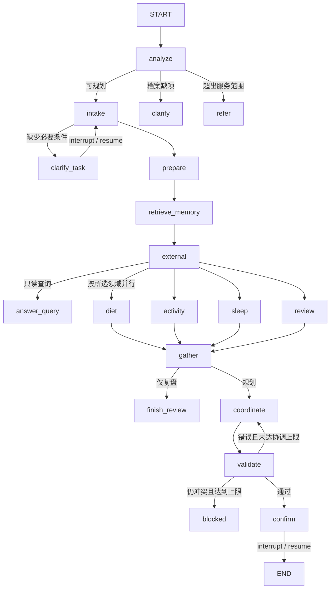
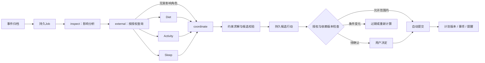

# 架构设计

Simon包含会话控制器与两张显式LangGraph。身份问候、位置状态可本地直接回答；完整规划和事件重排进入相应图。

## 系统分层

| 层 | 职责 | 主要源码 |
| --- | --- | --- |
| 交互 | 对话、候选、反馈、档案、权限与来源展示 | [live.html](../frontend/mobile/vivid/live.html)、[app.js](../frontend/mobile/vivid/app.js) |
| 个人状态 | Session / Goal / Task、事件、候选行动、反馈、复盘 | [agent.py](../app/personal/agent.py)、[continuity.py](../app/personal/continuity.py) |
| 图编排 | 条件路由、角色并行、汇合、有限返工和中断 | [健康图](../app/multi_agent/graph.py)、[事件图](../app/personal/planning.py) |
| 角色运行 | 独立messages、结构化提交、工具反馈循环、预算 | [deepseek.py](../app/multi_agent/runners/deepseek.py) |
| 证据与约束 | MCP、记忆补查、路线/时间约束、量化计算 | [integrations](../app/integrations)、[schedule_engine.py](../app/personal/schedule_engine.py) |
| 持久化 | 业务SQLite、LangGraph检查点、任务与来源日志 | [storage.py](../app/backend/storage.py)、[runtime.py](../app/personal/runtime.py) |

## 健康任务图



- `analyze`检查服务范围，专业支持字段的硬约束由程序控制。
- `intake`提取领域、时间、位置、查询范围和临时约束；`clarify_task`允许有界澄清，恢复时刷新有效位置与上下文。
- `external`只调用已授权工具，失败、缺失和未配置保留为证据状态。
- 同一superstep的所选角色完成后汇合。Review负责反馈分析，validate负责程序校验。
- `coordinate → validate`最多两次协调，即首稿加一次返工；仍冲突则停止。
- `confirm`通过interrupt等待明确决定，恢复后形成批准或拒绝结果。

State区分需求、有效档案、旧正式计划、草稿、证据、角色结果和运行状态。并行角色分别返回自己的字段；追加型证据使用reducer。节点返回增量，不共享可变messages。

## 事件图与图外行动层



会议影响运动时调度Activity；饭局、出差或作息冲突可触发多个领域。事件图输出候选，图外行动层负责存档、授权、确认和提交；它没有健康图的interrupt确认节点。

提交前检查计划版本、事件版本、业务修订、策略与反馈依赖。模型/网络执行时不一直持有业务锁，提交阶段重新核实依据。

## 角色内工具循环

```text
ContextBuilder组装输入 → 独立messages → 模型请求工具
  → Schema、白名单与调用额度检查 → 工具结果加入messages
  → 继续补查或submit_result → 输出Schema校验
```

必需证据必须在前一轮已返回；同批读取并立即提交不能算作已使用反馈。每批tool_call均配对返回，裁剪不会留下孤立tool_call_id。

默认限制：6轮模型循环、10次角色工具调用、3次历史补查；上下文以UTF-8字节估算。参数见[配置源码](../app/config.py)。

## 持久化与恢复

- 业务SQLite保存档案、记录、版本、事件、候选、事项与来源日志；独立checkpoint库保存图执行状态。
- 后台Job使用租约、尝试记录和幂等键；事件图根据检查点和依赖恢复或重算。
- 健康图恢复等待澄清与确认的任务；失败任务根据保存的状态重新发起。
- 两个数据库没有跨库原子事务，业务版本与幂等收尾负责避免重复提交。
- 使用本地单用户、单进程运行方式。
