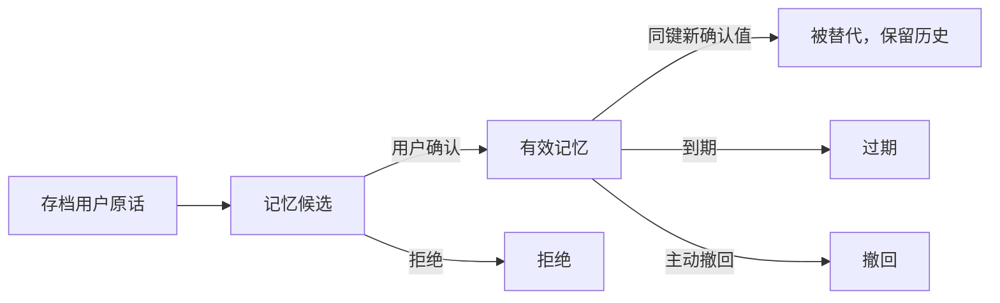

# 可追溯的记忆管理

## 工作视图、个人偏好和历史证据分开

| 类型 | 内容 | 权威来源 |
| --- | --- | --- |
| 工作视图 | 当前任务、有效档案、未完成事项、近期记录 | 本次业务状态与已确认数据 |
| 跨任务记忆 | 明确偏好、活动限制、临时条件及有效期 | 存档用户消息 + 用户确认 |
| 历史证据 | 原始消息、记录修订、计划版本与来源日志 | SQLite存档及修订记录 |

复盘观测与已确认偏好分别保存，历史事件通过来源索引关联原文。

## 生命周期

长期与临时作用域分开；缺少期限的临时条件不随意写成永久偏好。有效记忆变化会影响候选时效，防止按旧条件提交。

## 重新组装与自主补查

ContextBuilder按角色选择相关记忆、证据和旧计划字段。启动角色或协调返工时重新建立输入；角色内部通过工具消息反馈继续循环。

| 工具 | 作用 |
| --- | --- |
| `query_history` | 按日期范围、主题、关键词、计划版本和游标查询数据库 |
| `read_memories` | 读取有效偏好或其历史生命周期 |
| `read_history_message` | 根据已知来源ID分段回读原文，区分片段与完整消息 |

访问器不放进可序列化State或模型上下文，通过runner参数注入。主题、分页和额度由程序控制；补查不授予档案修改、记忆确认或任意URL访问权。

## 预算与来源

- ContextBuilder当前预算为16,000 UTF-8字节估算单位，非16k Token。
- 每轮消息与工具返回另有预算，优先保留规则、当前任务和完整工具配对。
- 裁剪的是模型看到的视图，原始存档不随裁剪删除。
- 截断结果标明有限性，不能替代需要精确回读的原话。
- 检索采用SQLite结构化过滤、参数查询与来源回读。

源码：[memory.py](../app/backend/memory.py) · [agent_history.py](../app/backend/agent_history.py) · [context_builder.py](../app/multi_agent/context_builder.py) · [continuity.py](../app/personal/continuity.py)
